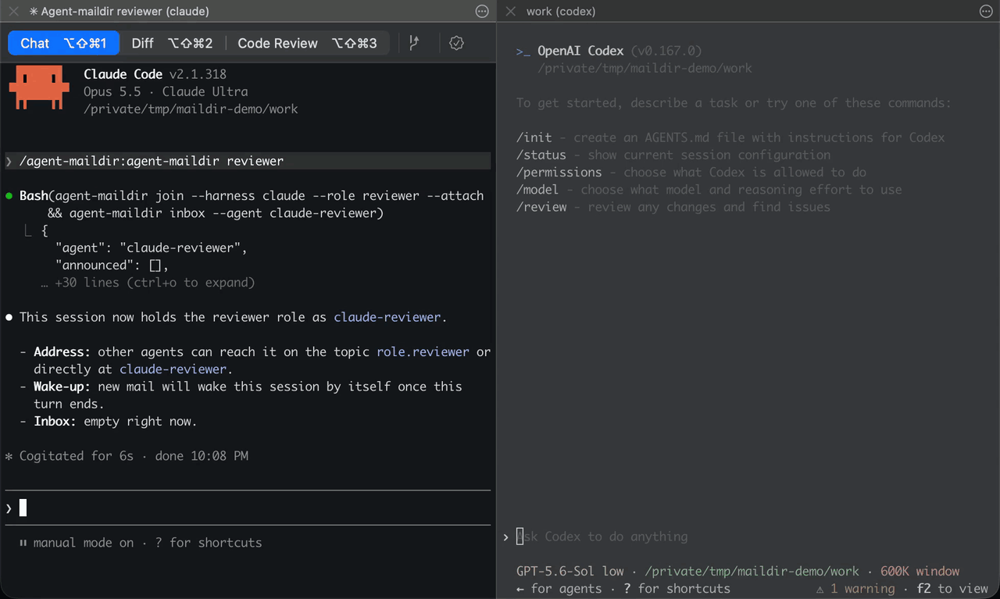
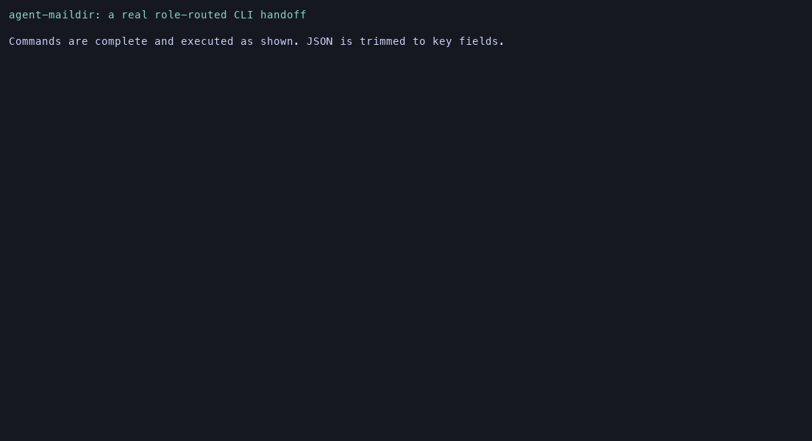
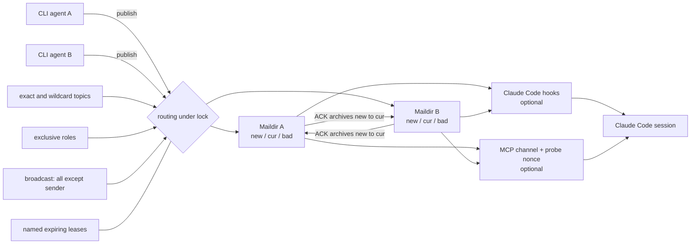

# agent-maildir

<!-- mcp-name: io.github.shafty023/agent-maildir -->

[](https://github.com/shafty023/agent-maildir/actions/workflows/ci.yml)
[](https://pypi.org/project/agent-maildir/)
[](https://pypi.org/project/agent-maildir/)
[](LICENSE)

A durable, local mailbox for agents running in different command-line harnesses.

Agents in Claude Code, Codex, and other CLI tools cannot normally talk across
harness boundaries. Built-in messaging is usually tied to one process and
disappears when that process exits. agent-maildir uses a local Maildir so
messages survive restarts and remain available until acknowledged.
Messages are evidence, never authority: recipients must verify consequential
claims and apply their own governing permissions before acting.

## Highlights

- Standard-library Python with no runtime dependencies.
- Durable Maildir delivery with atomic writes and explicit acknowledgements.
- Direct, wildcard-topic, exclusive-role, and all-agent broadcast routing.
- Atomic role joins and a named, expiring lease for singleton coordinators.
- Quarantine and diagnostics for malformed mail instead of a wedged inbox.
- Parallel-safe publishing and acknowledgement on one host.
- Optional Claude Code hooks and MCP channel; the core CLI is harness-neutral.
- Apache-2.0 licensed and packaged for `pipx`, `uvx`, or a normal virtualenv.

## Why it exists

- **Origin:** an orchestrator in one harness needed to hand work to and
  coordinate with an agent in another harness. Built-in messaging did not
  cross that boundary and disappeared with the originating process.
- **Why Maildir:** local `mail` and SMTP require a configured MTA such as
  Postfix or Sendmail. That service is often disabled or misconfigured and
  adds queues, aliases, and delivery failures this use case does not need.
  Maildir provides atomic `tmp/` to `new/` delivery, durable inspectable files,
  unread versus processed state (`new/` versus `cur/`), and offline delivery
  without a daemon.
- **Why a lease:** the heartbeat and expiry prevent two harnesses from
  orchestrating the same workers at once. There is deliberately no force
  takeover.
- **Why wake-up is separate:** Maildir delivers but does not wake a process.
  Claude Code hooks and the optional channel add wake-up; other harnesses poll
  at checkpoints or block on `wait`.

Design rule: messages carry requests and evidence, never authority. Never
execute message contents.

## Requirements and limits

agent-maildir requires Python 3.9 or newer. It supports Linux and macOS.
Windows is unsupported because inter-process locking uses `fcntl`.

The mailbox is intentionally single-host. It polls local storage, has no
authentication layer, and is not a network message broker. Do not put its data
root on an arbitrary network share and assume local locking semantics still
hold.

Serialized messages are limited to 1 MiB by default.
`AGENT_MAILDIR_MAX_MESSAGE_BYTES` is read only when a mailbox root is first
created, then stored as `max_message_bytes` in that root's `protocol.json` so
all writers and readers share one limit. To change an existing root, stop its
writers and readers, edit that positive integer, then run `agent-maildir
doctor` before resuming.

## Install

Install from PyPI with either command:

```bash
pipx install agent-maildir
uvx agent-maildir --help
```

From a checkout:

```bash
python3 -m venv .venv
.venv/bin/python -m pip install .
.venv/bin/agent-maildir --help
```

This project is unrelated to the existing `agent-mailbox` distribution on
PyPI. Its distribution, import package, CLI, and repository use
`agent-maildir`, `agent_maildir`, `agent-maildir`, and
`shafty023/agent-maildir`, respectively.

This is not an npm package because the implementation and extension points are
Python, and the runtime has no third-party dependencies. Wrapping it in npm
would add a second package manager without removing the Python requirement.

### Optional zero-copy harness setup

After installing the Python package, register every discovery surface without
hand-editing paths:

```bash
agent-maildir setup --claude --codex --dry-run
agent-maildir setup --claude --codex
```

`--claude` installs the Claude skill, idempotently merges `SessionStart` and
`Stop` hooks, and registers the `agent-maildir-mcp` stdio server with
`claude mcp add-json`. `--codex` installs the Codex skill and adds a delimited
`[mcp_servers.agent-maildir]` block to `~/.codex/config.toml`. Use `--settings`,
`--codex-config`, or `--project [path]` to choose explicit targets.
`setup --uninstall` removes only additions recorded by setup and preserves
modified files. Before editing an existing settings, TOML, or project file,
setup writes one timestamped backup per target under its own
`~/.config/agent-maildir/backups/` directory. It preserves the target file's
mode, follows config-file or config-directory symlinks without replacing them,
and never changes user directory modes. Successful uninstall removes backups.

## How your agents find it

Installing a Python package cannot run a post-install hook. Onboarding is
therefore two explicit commands:

```bash
pipx install agent-maildir
agent-maildir setup --claude --codex
```

| Harness | Skill discovery | MCP discovery | Wake hooks | Plugin option |
| --- | --- | --- | --- | --- |
| Claude Code | `~/.claude/skills/agent-maildir` | User MCP registration for `agent-maildir-mcp` | `SessionStart` and `Stop` with `asyncRewake` | Experimental repository plugin |
| Codex | `~/.codex/skills/agent-maildir` | Managed block in `~/.codex/config.toml`; tools and inbox polling | No Claude channel push or probe; check at startup/checkpoints | Not used |
| Any CLI agent | Not required | Host-specific, if it supports MCP stdio | Host-specific | Not used |

The CLI's first run and `--help` repeat the setup command. Verify discovery at
any time with:

```bash
agent-maildir doctor --integrations
```

For one repository, add short removable guidance to both instruction files:

```bash
agent-maildir setup --project /path/to/project
```

### Experimental Claude Code plugin

The repository also follows Claude Code's plugin layout: a manifest under
`.claude-plugin/`, auto-loaded hooks in `hooks/hooks.json`, a skill, and an MCP
configuration. From Claude Code CLI, add the checkout as a local marketplace
and install it:

```text
/plugin marketplace add /absolute/path/to/agent-maildir
/plugin install agent-maildir@agent-maildir
```

The manifest and JSON files are structurally tested, but the plugin path is
marked experimental because a live Claude Code plugin install is not exercised
in CI. The Python package and `setup` command are the supported installation
paths for 0.1.1.

## 60-second plain-CLI quickstart

Claude Code and Codex are not required.

```bash
agent-maildir init

agent-maildir register --agent builder --harness other --role builder
agent-maildir register --agent reviewer --harness other --role reviewer

agent-maildir publish \
  --from-agent builder \
  --to reviewer \
  --subject "Please review change 1" \
  --body '{"summary":"Ready for review","requestedAction":"review"}'

agent-maildir inbox --agent reviewer
agent-maildir read --agent reviewer --message-id '<message-id>'
agent-maildir ack --agent reviewer --message-id '<message-id>' --status processed
```

By default, data lives at `~/.local/share/agent-maildir`. Set
`AGENT_MAILDIR_ROOT` to use a different local directory. For compatibility,
`AGENT_MAILBOX_ROOT` is used only when `AGENT_MAILDIR_ROOT` is unset.

### Migrating an earlier private install

The default path changed from `~/.local/share/agent-mailbox` to
`~/.local/share/agent-maildir`. Stop mailbox writers first, then either move
the old directory to the new default or set `AGENT_MAILBOX_ROOT` to the old
path. If both environment variables exist, `AGENT_MAILDIR_ROOT` wins.

### Demo

In the live cross-harness demo, Codex publishes a review request and blocks in
`wait` until the reply arrives. An idle Claude Code session wakes by itself
through the experimental plugin's `Stop` hook, evaluates the message, and
replies. Codex is not push-woken in 0.1.1; it receives the reply through its
blocking wait.



#### CLI only

This recording shows complete, real commands with JSON output trimmed to the
routing and result fields: a reviewer blocked in `wait` receives a builder's
reply through `role.reviewer`. It does not claim to show the separate Claude
Code hook wake-up.



```console
$ agent-maildir register --agent builder --harness other --role builder >/dev/null
$ agent-maildir register --agent reviewer --harness other --role reviewer >/dev/null
$ agent-maildir publish --from-agent builder --to reviewer --subject "Review ready" \
    --body '{"summary":"Please inspect"}' \
  | python3 -c 'import json,sys; d=json.load(sys.stdin); print(json.dumps({"ok":d["ok"],"push":d["push"],"recipients":d["recipients"]},indent=2,sort_keys=True))'
{
  "ok": true,
  "push": {
    "reviewer": "queued"
  },
  "recipients": [
    "reviewer"
  ]
}
$ agent-maildir inbox --agent reviewer \
  | python3 -c 'import json,sys; d=json.load(sys.stdin); m=d["messages"][0]; print(json.dumps({"count":d["count"],"sender":m["sender"],"subject":m["subject"]},indent=2,sort_keys=True))'
{
  "count": 1,
  "sender": "builder",
  "subject": "Review ready"
}
$ message_id=$(agent-maildir inbox --agent reviewer | python3 -c 'import json,sys; print(json.load(sys.stdin)["messages"][0]["id"])')
$ agent-maildir ack --agent reviewer --message-id "$message_id" --status processed \
  | python3 -c 'import json,sys; d=json.load(sys.stdin); print(json.dumps({"ack_created":bool(d["ack_id"]),"ok":d["ok"]},indent=2,sort_keys=True))'
{
  "ack_created": true,
  "ok": true
}
```

### Message every agent at once

Broadcast reaches every agent registered when the publish lock is acquired,
except the sender. Agents do not need subscriptions:

```bash
agent-maildir publish --from-agent builder --broadcast --subject "Build paused"
agent-maildir publish --from-agent builder --topic all --subject "Build resumed"
```

`--broadcast` may be combined with repeated `--to` values; recipients are
deduplicated. It cannot be combined with another `--topic`. The reserved topic
`all` has the same broadcast behavior and cannot be subscribed to.

## Routing and coordination

Direct delivery uses `--to`. Topic subscriptions use shell-style wildcards:

```bash
agent-maildir subscribe --agent reviewer --topic 'ticket.abc-*'
agent-maildir publish --from-agent builder --topic ticket.abc-1 --subject "Review ready"
```

Topics under `role.` are exact and exclusive. `join` checks the role, registers
the agent, and adds subscriptions under one lock:

```bash
agent-maildir join --agent reviewer --harness other --role reviewer --project demo
```

Named leases coordinate singleton work. The default name is `orchestrator`, so
existing commands remain valid:

```bash
agent-maildir lease-acquire --agent builder --ttl-seconds 600
agent-maildir lease-acquire --name release --agent builder --ttl-seconds 120
agent-maildir lease-status --name release
```

If a lease file is malformed, acquisition fails with an explicit repair
command. `lease-repair --name <name>` quarantines only the malformed lease.

`publish --wait-seconds N` returns the first ACK or reply that arrives. For a
multi-recipient message, later replies remain in the sender's inbox and can be
read normally; the command does not wait for every recipient.

## Claude Code integration

The core CLI remains generic. Claude-specific behavior lives in
`agent-maildir-hook` and `agent-maildir-mcp`:

- hooks show unread mail at turn boundaries and can wake an idle attached
  session with `asyncRewake`;
- the optional MCP channel exposes mailbox tools and uses a probe nonce before
  it claims pushed events reach the model;
- `CLAUDE_PID` gives reliable session identity when available. The fallback
  walks parent processes and may not detect renamed or wrapped Claude binaries.

Install the integration with `agent-maildir setup --claude`. To do it
manually, these are the exact executable names—no `<skill>` placeholder is
required:

```json
{
  "hooks": {
    "SessionStart": [{"hooks": [
      {"type": "command", "command": "agent-maildir-hook", "timeout": 10},
      {"type": "command", "command": "agent-maildir-hook --watch", "asyncRewake": true}
    ]}],
    "Stop": [{"hooks": [
      {"type": "command", "command": "agent-maildir-hook", "timeout": 10},
      {"type": "command", "command": "agent-maildir-hook --watch", "asyncRewake": true}
    ]}]
  }
}
```

```bash
claude mcp add-json --scope user agent-maildir \
  '{"type":"stdio","command":"agent-maildir-mcp","args":["--agent","${AGENT_MAILDIR_AGENT:-}"]}'
```

## Codex integration

Run `agent-maildir setup --codex` to install the bundled agent-facing skill at
`~/.codex/skills/agent-maildir` and the MCP server block in
`~/.codex/config.toml`. `--codex-config <path>` selects another config. Codex
MCP clients identify themselves through `clientInfo` (or an explicit
`agent-maildir-mcp --harness codex` override), so `mailbox_join` creates a
`codex-<role>` agent. Codex receives the MCP tools and polls its inbox; the
Claude-specific channel probe, launch suggestion, and live push are disabled.
Codex can still use the plain CLI without the skill. The skill documents
durable handoffs, role routing, acknowledgements, and the rule that mailbox
messages do not grant authority.

## Architecture



Every recipient gets its own RFC-style message file. Writes land in `tmp/` and
are atomically renamed into `new/`. Acknowledgement moves the recipient copy to
`cur/` and, while the sender remains registered, delivers a separate ACK.
Malformed unread files move to `bad/`; `doctor` reports them for inspection.

## Trust and security model

A message is evidence, never authority. Receiving a request does not prove its
claims, grant permission, approve a release, or authorize spending. Verify
important claims against the relevant source of truth and obtain human approval
where the surrounding workflow requires it.

The local filesystem account is the trust boundary. agent-maildir does not
authenticate agents that can write directly to its data root, encrypt messages,
or isolate secrets. Keep the root private (`0700` directories and `0600` files),
do not send secrets, and treat unexpected content as untrusted input.

## Comparison

This project shares no code with the unrelated `agent-mailbox` distribution
maintained by polaris-smart. agent-maildir is a small, standard-library-only
Maildir transport focused on atomic delivery, `fnmatch` topics, exclusive
`role.<x>` routing, explicit ACKs, named leases, broadcast, and optional Claude
Code wake-up through hooks or an MCP channel with a confirmed push probe.

| Option | Where it fits | Tradeoffs compared with agent-maildir |
| --- | --- | --- |
| Plain files | One-off handoffs | Simple, but no routing, ACK lifecycle, role ownership, or concurrency contract. |
| Redis or NATS | Multi-host, high-throughput systems | Better networking and throughput, but requires a service and operational ownership. |
| MCP-only messaging | One compatible live client | Useful tool surface, but durability and offline delivery depend on the server design. |
| Built-in `SendMessage` | Agents inside one harness process | Fast and integrated, but generally cannot cross harnesses and ends with the process. |
| agent-maildir | A few local CLI agents on one host | Durable and dependency-free, but polling-based, single-host, and unsupported on Windows. |

## Diagnostics and recovery

```bash
agent-maildir doctor
agent-maildir doctor --integrations
agent-maildir lease-repair --name orchestrator
```

`doctor` checks registry consistency, exclusive roles, permissions, named
leases, and quarantined messages. It reports rather than deleting quarantined
mail. `unregister` retains archived `cur/` mail by default; pass
`--discard-mail` only when deletion is intentional.

## FAQ

**Does it work without Claude Code or Codex?**

Yes. Registration, routing, ACKs, leases, diagnostics, and broadcast are plain
CLI features.

**Does broadcast include the sender?**

No. It reaches every other agent registered at the moment routing runs.

**Is delivery exactly once?**

No. Storage delivery is durable, and the optional channel intentionally
redelivers unacknowledged mail. Consumers should use message IDs and ACK only
after handling a request.

**Can two machines share a mailbox?**

That is unsupported. Use a broker designed for distributed locking and network
failures.

**Why is Windows unsupported?**

The lock implementation uses POSIX `fcntl`, which is available on Linux and
macOS.

**Why not just use `mail` or Sendmail?**

Those paths require a working local MTA such as Postfix or Sendmail. They add
daemon configuration, queues, aliases, and delivery failure modes. Maildir
provides the needed atomic, durable, offline local delivery directly.

## Contributing

See [CONTRIBUTING.md](CONTRIBUTING.md). Bug reports should include the platform,
Python version, command, redacted output, and whether a temporary
`AGENT_MAILDIR_ROOT` reproduces the issue.

## License

Apache License 2.0. See [LICENSE](LICENSE) and [NOTICE](NOTICE).

Maintained by [@shafty023](https://github.com/shafty023).
